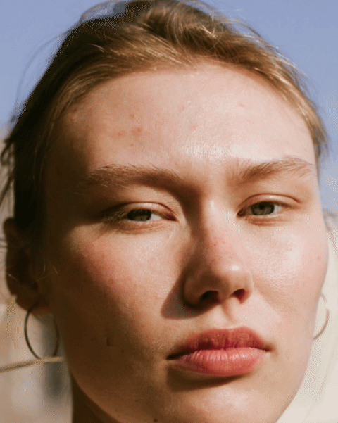

# 톤빛 ToneBit

**https://tonebit.vercel.app**

셀카 한 장으로 웜·쿨과 시즌 톤을 가늠하고, 올리브영 베스트 립 196색을 내 얼굴에 발라 보고 고르는 웹 서비스입니다. 얼굴 사진은 기기 밖으로 나가지 않습니다.



## 무엇을 하나

- **톤 가늠.** 볼·이마 색을 재서 웜·쿨과 12시즌 중 가능성이 높은 톤을 확률과 함께 보여 줍니다. 치아·눈 흰자·흰 종이를 기준으로 조명을 되돌리고, 왜 그렇게 봤는지 문장으로 풀어 줍니다.
- **립·블러셔 발라 보기.** 제품 색을 입술과 볼에 실시간으로 얹습니다. 입술의 결과 반짝임은 남기고 색만 바꿉니다.
- **내 립 찾기.** 측정 뒤 한 화면에 한 가지 일만 묻는 다섯 단계로 갑니다. 내 톤 → 원하는 느낌 → 좋아하는 질감 → 둘 중 고르기(내 얼굴에 바른 두 립 중 나은 쪽을 일곱 번) → 내 립 순위.
- **내 얼굴 기준 립 순위.** 밝기 대비·색 방향(웜·쿨)·혈색·선명도·색 조화·톤 팔레트·유행·인상·질감·치아 열 각도로 점수를 매깁니다. 최적점이 세부 타입·눈썹 자연 대비·취향으로 움직이고, 둘 중 고르기의 선택으로 가중치를 배워서 사람마다 다른 순위가 나옵니다. 각 행에 그 립을 바른 내 얼굴과 구매 링크가 붙습니다.
- **내 제품 색 재기.** 가진 립을 흰 종이에 발라 찍으면 색을 재서 순위에 넣고, 더 어울리는 제품을 알려 줍니다.
- **AI 상담.** 결과에 맞춰 제품과 가이드를 찾아 답하고, 답에 나온 색을 사진에 바로 발라 봅니다.

## 정확도에 대해

셀카로 4시즌을 맞히는 공개 연구의 최고치는 약 55%입니다. 그래서 한 시즌을 단정하지 않고 확률과 다음 후보를 같이 보여 주고, 마지막 판정은 사용자의 눈(셀프 비교·둘 중 고르기)에 맡깁니다.

FairFace 동아시아인 1,176장으로 검증한 것은 "조명이 바뀌어도 같은 결과가 나오는가"입니다(시즌 86.8%, 12톤 74.5%). 정답 라벨이 있는 공개 데이터가 없어 정답과의 일치는 재지 못했고, 이용자가 알려 준 전문가 진단이 모이면 매주 교차검증으로 기준을 다시 맞춥니다. 자세한 근거는 [docs/color-analysis.md](docs/color-analysis.md)에 있습니다.

## 프라이버시

얼굴 인식과 색 분석은 전부 브라우저에서 끝납니다. 모델·wasm·폰트를 자체 호스팅하고 CSP `connect-src 'self'`로 외부 연결을 브라우저 수준에서 막았습니다. 서버로 가는 것은 측정 숫자와 글뿐입니다. [docs/privacy.md](docs/privacy.md)

## 기술

Next.js 16 · React 19 · TypeScript · Tailwind v4 · Zustand · MediaPipe Face Landmarker · Postgres + pgvector · Gemini · Vitest · Playwright · GitHub Actions

## 시작하기

```bash
pnpm install
pnpm dev                                   # http://localhost:3000 (카메라는 localhost 또는 HTTPS)
pnpm lint && pnpm typecheck && pnpm test
pnpm e2e                                   # Playwright, 가짜 카메라 + 고정 셀카
pnpm build
```

DB·AI 상담까지 로컬에서 돌리는 방법, 배포, 환경 변수는 [docs/operations.md](docs/operations.md)에 있습니다.

## 구조

```
src/features/
  analysis/    색 분석 순수 함수 (샘플링, 조명 보정, 판정, 확률, 재보정)
  camera/      카메라 스트림, 흰 종이 화이트밸런스 고정
  landmark/    MediaPipe Face Landmarker, 랜드마크 기하
  lipTryOn/    입술·볼 마스크와 발색, 얼굴 크롭
  recommend/   팔레트, 제품 데이터, 어울림 점수(열 각도), 취향·가중치 학습, 유행, 둘 중 고르기 대진, 셀프 비교
  myShade/     내 제품 색 재기
  advisor/     AI 상담 (Gemini 함수 호출 + pgvector 검색)
  feedback/    전문가 진단 피드백, 일치율 집계
  try/         /try 화면 (카메라·사진 → 측정 → 단계 라우터 → 발라 보기)
  flow/        측정 뒤 단계 화면 (내 톤 → 느낌 → 질감 → 둘 중 고르기 → 내 립, 정확도 높이기, AI 상담)
```

- [docs/architecture.md](docs/architecture.md) — 화면 구조, 프레임 흐름, 서버 데이터 루프, AI 상담 설계
- [docs/color-analysis.md](docs/color-analysis.md) — 샘플링, 조명 보정, 판정 기준, 문헌과 FairFace 실측
- [docs/lip.md](docs/lip.md) — 립 어울림 점수(열 각도·취향 학습), 발색 모델, 둘 중 고르기, 제품 데이터
- [docs/privacy.md](docs/privacy.md) — 프라이버시 설계
- [docs/operations.md](docs/operations.md) — 개발, 배포, 분석 이벤트, 검색엔진, 수익화

## 다음 단계

- 전문가 진단 피드백을 모아 조명 기준별로 재보정 돌리기
- 남은 근사치 제품 색을 실물로 재서 바꾸기
- 같은 제품의 바르기 전·후 셀카로 발색 값 맞추기
- 모바일 FPS가 낮으면 랜드마커를 Web Worker로
