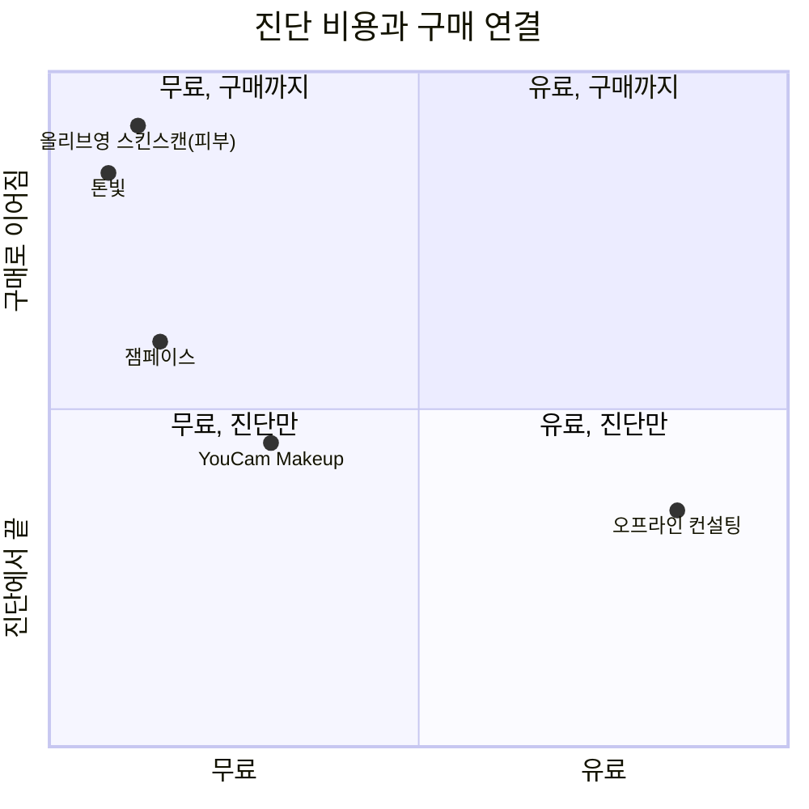

# 1. 사전 시장조사

> **결론:** 들어갈 이유가 있다. 셀카로 퍼스널 컬러를 가늠해 주는 무료 앱은 이미 여럿이지만, 진단에서 "내 얼굴에 바른 립 → 바로 구매"까지 한 흐름으로 잇고 사진을 서버로 보내지 않는 서비스는 비어 있다. 다만 큰 유통사가 피부 진단에서 퍼스널 컬러로 넘어오는 중이라(올리브영이 2026년 안에 추가 예정) 시간이 길지 않다. 작게, 무료로, 빨리 내고 지표로 확인한다.

조사 시점: 2026-11-11.

---

## 1. 시장 배경

퍼스널 컬러 진단은 오프라인 1:1·소그룹 컨설팅이 중심이고, 셀카 기반 AI 진단 앱과 유통사의 매장·앱 진단이 그 아래를 채우고 있다.

| 시장 신호 | 수치 | 출처, 시점 |
|---|---|---|
| 오프라인 컨설팅 가격 | 종합 컨설팅 4만 원대부터, 평균 6만 원대(컬러·메이크업·패션 2~3시간 패키지), 풀스타일링 15만 원 이상 | [크몽 가격 가이드](https://kmong.com/prices/%ED%97%A4%EC%96%B4-%EB%A9%94%EC%9D%B4%ED%81%AC%EC%97%85-%EC%BB%A8%EC%84%A4%ED%8C%85), 2025-09-17 |
| 강남 스튜디오 그룹 진단 | 1인 45,000원(2~3인, 60~90분) | [컬러라이즈 상품 페이지](https://www.colorize.co.kr/m2/goods/view.php?category=004&goodsno=62) |
| 외국인 관광객 수요 | 크리에이트립 2024년 상반기 뷰티숍 거래 건수 전년 대비 약 514% 증가, 거래액 약 2000% 증가, 뷰티숍 거래액의 약 80%가 퍼스널 컬러 진단 | [위키트리(브런치)](https://brunch.co.kr/@wikitree/7286), 2026-08-12. 한 예약 플랫폼의 내부 자료 |
| 매장 진단 이용자 | 올리브영N 성수 피부·두피 컨설팅 이용자의 60~70%가 외국인 | 같은 글, 회사 발표 |
| 맞춤형 화장품 | 세계 시장 2020년 7억 5,300만 달러 → 2023년 11억 4,400만 달러(51.9% 성장) | [세계일보](https://www.segye.com/newsView/20260312515503), 2026-03-14, 식약처 자료집 인용 |
| 유통사의 AI 진단 | 올리브영 '스킨스캔' 2024-04 매장 도입 → 2026-09 모바일 확대, 퍼스널 컬러 진단은 연내 추가 예정 | [MTN](https://news.mtn.co.kr/news-detail/2026091509334725588), 2026-09-15 |
| 브랜드의 AI 진단 | 아모레퍼시픽 맞춤 파운데이션 월 평균 1,500명, 누적 1만 명, 평일 이용자 80% 이상이 외국인. 헤라 딥톤은 AI로 명도·채도·언더톤 측정 | 세계일보, 위와 같음 |

읽는 법은 이렇다. 진단 자체는 돈을 받을 수 있는 서비스로 자리 잡았고(4만~15만 원), 외국인에게는 K-뷰티 체험 상품이 됐다. 유통사와 브랜드는 진단을 상품 추천의 입구로 쓰기 시작했다. 즉 "진단 → 추천 → 구매"가 업계가 가는 방향이고, 아직 개인이 집에서 무료로 그 흐름을 끝까지 타는 서비스는 드물다.

## 2. 이용자

립을 고를 때 "내 톤"을 기준으로 삼고 싶은 사람이다. 진단을 받고 싶지만 예약과 비용이 부담이거나, 앱으로 진단은 받았는데 결과가 "여름 쿨"에서 끝나 막상 뭘 살지 모르는 사람.

| 구분 | 뷰티 입문 20대 | 립 자주 사는 30대 | (이후) 외국인 관광객 |
|---|---|---|---|
| 상황 | 퍼스널 컬러를 SNS에서 보고 궁금한데 진단비가 아깝다 | 립을 자주 사는데 색을 고를 때마다 실패한다 | 한국에서 진단과 쇼핑을 한 번에 하고 싶다 |
| 원하는 것 | 지금 바로, 공짜로, 대충이라도 내 톤 | 내 얼굴에 발라 본 뒤 고르고, 사러 가기 | 언어 걱정 없이 진단표와 제품 목록 |
| 걱정 | 사진이 어디로 가나 | 결과가 맞나, 유행은 반영됐나 | 영어 지원 |
| 톤빛의 답 | 셀카 한 장, 기기 안에서 끝 | 얼굴에 발라 보기, 둘 중 고르기, 유행 순위, 구매 링크 | 범위 밖(한국어만). 지표가 나오면 검토 |

이용자가 하려는 일(jobs)은 네 가지로 좁혔다. 진단받기(무료로, 지금), 믿을 만한지 확인하기, 립 고르기(내 얼굴에 발라 보고), 사기(링크 한 번).

## 3. 경쟁·대체 서비스

| 서비스 | 진단 방식 | 비용 | 사진 처리 | 진단 뒤에 이어지는 것 | 출처 |
|---|---|---|---|---|---|
| 오프라인 컨설팅 | 전문가가 천(드레이프)을 대 보며 판정, 40~90분 | 4.5만~15만 원 이상 | 해당 없음 | 진단표, 구두 추천. 구매는 따로 | 크몽, 컬러라이즈, 위키트리 |
| 잼페이스 | 사진 한 장으로 퍼컬 타입과 피부 타입 진단 | 무료 | 앱 서버 처리로 추정(명시 없음) | 제품·스타일 추천, 포인트몰. 평점 4.4(6.4천 개) | [App Store](https://apps.apple.com/kr/app/id1460572087) |
| YouCam Makeup(퍼펙트) | AI 에이전트에 정면 사진 올리면 약 3초 분석 | 무료로 시작 | 서버 처리로 추정 | 립스틱·의상 추천, 가상 메이크업(립·블러셔·파운데이션·헤어) | [퍼펙트 블로그](https://www.perfectcorp.com/ko/consumer/blog/makeup/personal-color-analysis-app), 2026-06-02, 홍보 글 |
| 올리브영 스킨스캔 | 문진 뒤 얼굴 촬영·사진 선택, AI 피부 진단(모공·색소·수분 등) | 무료(앱) | 서버 처리로 추정 | 맞춤 관리 루틴·상품 제안. 퍼스널 컬러는 연내 추가 예정 | MTN, 2026-09-15 |
| 톤빛 | 셀카 또는 카메라, 브라우저 안에서 얼굴 인식·색 분석 | 무료 | 기기 밖으로 안 나감 | 내 얼굴에 발라 보기, 둘 중 고르기로 취향 반영, 인기 제품 순위, 쿠팡 링크 | 이 저장소 |

비용과 구매 연결 두 축으로 놓으면 이렇게 보인다. 위치는 위 표를 보고 내가 놓은 것이라 정밀한 값은 아니다.

톤빛이 노리는 자리는 "무료인데 구매까지"다. 올리브영은 같은 자리에 있지만 아직 피부 진단이고, 추천이 자기 매장 상품으로 닫혀 있다. 톤빛은 브랜드·몰과 무관하게 인기 제품을 순위로 보여 주고 어느 몰이든 링크로 보낸다.

## 4. 기회와 위험

| 기회 | 근거 |
|---|---|
| 무료, 설치 없음, 바로 결과 | 오프라인은 4.5만 원부터, 앱은 설치와 가입이 필요하다 |
| 사진이 기기 밖으로 안 나감 | 경쟁 앱은 사진을 서버로 보내는 것으로 보인다. 얼굴 사진에 민감한 사람과 외국인에게 차별점 |
| 진단에서 구매까지 한 흐름 | 업계가 가는 방향(유통사·브랜드)인데 개인용 무료 서비스는 비어 있다 |
| 12톤 결과 페이지 | 톤마다 정적 페이지와 공유 카드가 있어 검색과 SNS로 유입을 받을 수 있다 |
| 전문가 진단 데이터 | 진단받아 본 이용자가 알려 주면 기준을 매주 다시 맞춘다. 쓰일수록 정확해지는 구조 |

| 위험 | 대응 |
|---|---|
| 정확도를 못 믿는다. 2026년 한 연구는 웜·쿨 차이는 뚜렷하지만 4계절 영역은 상당 부분 겹친다고 했다(위키트리 인용) | 가능성 %와 다음 후보를 같이 보여 주고, 두 톤 경계면 낮은 확신도로 표시한다. 사진 여러 장을 합치고, 전문가 진단 일치율을 공개 페이지에 둔다 |
| 조명 때문에 사진마다 결과가 다르다 | 치아·눈 흰자·흰 종이를 기준으로 조명을 되돌린다. 형광등·전구색이 섞이면 흰색 기준을 권한다 |
| 올리브영 같은 대형 유통사가 같은 기능을 낸다 | 특정 몰에 묶이지 않은 중립 추천, 기기 내 처리, 취향 학습으로 다른 자리를 잡는다. 지표가 안 나오면 접는다 |
| 수익이 작다 | 비용을 0으로 유지한다(Vercel·Supabase·Gemini 무료 등급). 쿠팡 파트너스 외 수익화는 미루고, 수익이 붙는 시점에 호스팅을 옮긴다 |
| 제품 데이터가 낡는다 | 브랜드 공식 칩 색을 쓰고, 인기 순위를 분기마다 갱신한다. 쇼핑몰 크롤링은 하지 않는다 |

## 5. 결론과 범위

들어간다. 범위는 립(블러셔는 보조), 웹(앱 설치 없음), 한국어, 무료. 성공 여부는 "측정을 끝낸 사람 중 구매 링크를 누른 비율"로 본다. 외국인·영어 지원은 지표가 나온 뒤에 판단한다.

## 출처

- [위키트리(브런치), 외국인이 한국에서 '진단'을 쇼핑하는 이유, 2026-08-12](https://brunch.co.kr/@wikitree/7286)
- [세계일보, 개인화 뷰티 기사, 2026-03-14](https://www.segye.com/newsView/20260312515503)
- [MTN, CJ올리브영 '스킨스캔' 모바일로 확대, 2026-09-15](https://news.mtn.co.kr/news-detail/2026091509334725588)
- [크몽, 패션·헤어·메이크업·퍼스널 컬러 컨설팅 비용, 2025-09-17](https://kmong.com/prices/%ED%97%A4%EC%96%B4-%EB%A9%94%EC%9D%B4%ED%81%AC%EC%97%85-%EC%BB%A8%EC%84%A4%ED%8C%85)
- [컬러라이즈, 퍼스널컬러 그룹 진단 상품 페이지](https://www.colorize.co.kr/m2/goods/view.php?category=004&goodsno=62)
- [퍼펙트 블로그, YouCam 퍼스널 컬러 진단, 2026-06-02](https://www.perfectcorp.com/ko/consumer/blog/makeup/personal-color-analysis-app)
- [App Store, 잼페이스](https://apps.apple.com/kr/app/id1460572087)
