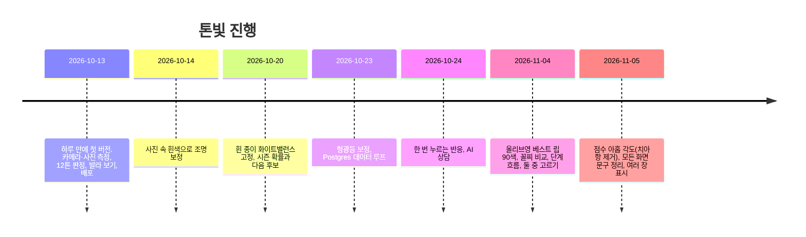

# 2. 서비스 기획서

> **한 줄:** 셀카 한 장으로 내 톤을 가늠하고, 어울리는 립을 내 얼굴에 발라 본 뒤 바로 사러 가는 무료 웹 서비스.

기준일 2026-11-11. 서비스명 톤빛(ToneBit), 주소 https://tonebit.vercel.app.

---

## 1. 배경과 문제

뷰티와 유통에 관심이 있었고, 평소 관심 있던 퍼스널 컬러를 아이템으로 골랐다. 하고 싶었던 건 돈을 들이지 않고 최대한 정확하게 진단하고, 그 결과가 구매로 이어지는 마케팅 혹은 서비스 차원의 무언가였다.

지금 시장에서 이용자가 겪는 문제는 네 가지다.

| 문제 | 지금 어떻게 되나 |
|---|---|
| 진단이 비싸고 예약해야 한다 | 오프라인 4.5만~15만 원, 40~90분 |
| 앱 진단은 결과가 "여름 쿨"에서 끝난다 | 그래서 뭘 사야 하는지는 따로 찾아야 한다 |
| 얼굴 사진을 서버로 보내는 게 꺼려진다 | 대부분의 앱이 사진을 올려 분석한다 |
| 추천이 "이 시즌엔 이 색" 수준이다 | 내 얼굴에 발라 본 모습도, 내 취향도 반영되지 않는다 |

## 2. 목표와 목표 아닌 것

| 목표 | 어떻게 재나 |
|---|---|
| 측정을 시작한 사람이 결과까지 간다 | 측정 완료율(measure-done ÷ try-start) |
| 결과를 본 사람이 립을 사러 간다 | 구매 링크 클릭률(product-click ÷ measure-done) |
| 결과를 믿을 수 있다 | 전문가 진단 일치율(공개 페이지), "비슷해요" 반응 비율 |
| 비용이 0이다 | 월 지출 0원 유지 |

목표가 아닌 것: 회원가입, 네이티브 앱, 전문가 진단의 대체, 피부 질환 판별, 쇼핑몰 크롤링, 유료 기능, 영어 지원(지표 뒤 판단).

## 3. 타깃

립을 고를 때 내 톤을 기준으로 삼고 싶은 20~30대. 자세한 페르소나는 [시장조사 2절](./01-market-research.md#2-이용자).

## 4. 가치 제안

| 이용자가 원하는 것 | 톤빛이 주는 것 | 대안과 다른 점 |
|---|---|---|
| 지금 바로, 공짜로 | 설치·가입 없이 셀카 한 장, 브라우저에서 10초 안쪽 | 오프라인은 예약과 비용, 앱은 설치와 가입 |
| 사진 걱정 없이 | 얼굴 인식과 색 분석이 브라우저 안에서 끝나고 서버로 보내는 사진이 없다 | 경쟁 앱은 서버 처리로 보인다 |
| 믿을 만한 결과 | 가능성 %와 다음 후보, 확신도, 사진 여러 장 합치기, 치아·흰자·흰 종이 기준 조명 보정, 전문가 진단 일치율 공개 | 결과만 던지고 근거는 없다 |
| 뭘 살지 알고 싶다 | 인기 립 204개를 내 피부에 맞춘 순위로, 내 얼굴에 발라 본 모습으로, 꼴찌와 1등 비교로 | 시즌별 추천 색 목록 |
| 내 취향 반영 | 내 얼굴에 바른 두 립 중 나은 쪽을 일곱 번 고르면 순위가 내 눈에 맞춰 바뀐다 | 없음 |
| 바로 사기 | 순위·비교·발라 보기·결과 카드 어디서든 구매 링크 | 추천에서 끝 |

## 5. 핵심 기능과 우선순위

P0는 없으면 서비스가 아닌 것, P1은 첫 출시에 넣은 것, P2는 지표를 보고 넣은 것이다. 상태는 2026-11-11 기준.

| 우선순위 | 기능 | 설명 | 상태 |
|---|---|---|---|
| P0 | 셀카·카메라 측정 | 얼굴 인식 → 볼·이마 색 → 12톤 중 하나와 가능성 % | 출시됨 |
| P0 | 기기 내 처리 | 사진·프레임이 브라우저 밖으로 안 나감 | 출시됨 |
| P0 | 내 립 순위 | 인기 립을 아홉 각도 점수로 내 피부에 맞춰 순위 | 출시됨 |
| P0 | 얼굴에 발라 보기 | 립·블러셔를 사진 위에 자연스럽게 발색 | 출시됨 |
| P0 | 구매 링크 | 쿠팡 파트너스 링크, 어느 화면에서 눌렀는지 기록 | 출시됨 |
| P1 | 조명 보정 | 치아·눈 흰자 기준 자동, 흰 종이·흰 벽은 이용자가 눌러서 | 출시됨 |
| P1 | 사진 여러 장 합치기 | 최대 5장, 채널별 중앙값, 갈리면 경계 표시 | 출시됨 |
| P1 | 결과 카드와 공유 | 12톤 정적 페이지, 톤별 OG 카드, 공유·저장 | 출시됨 |
| P1 | 취향 질문 | 느낌(자연·화사·또렷)과 질감(촉촉·보송·상관없음) | 출시됨 |
| P2 | 둘 중 고르기 | 8강 토너먼트 일곱 번으로 가중치 학습 | 출시됨(11-04) |
| P2 | 꼴찌와 1등 비교 | 인기 제품 중 가장 안 어울리는 것과 나란히 | 출시됨(11-04) |
| P2 | 전문가 진단 피드백과 재보정 | 진단받은 사람이 알려 주면 매주 기준 재계산, 일치율 공개 | 출시됨 |
| P2 | AI에게 물어보기 | 진단 숫자와 질문만 보내 립·피할 색 상담, 사진 미전송 | 출시됨(환경 변수로 켬) |
| P2 | 내 제품 색 재기 | 흰 종이에 바른 립을 찍어 내 제품을 순위에 넣기 | 출시됨 |
| 이후 | 영어 지원 | 외국인 관광객 세그먼트 | 미정 |
| 이후 | 블러셔·아이섀도 순위 | 립과 같은 점수 체계 확장 | 미정 |

## 6. 사용 흐름

본 흐름은 다섯 단계이고 한 화면에 한 가지 일만 둔다. 곁가지 두 개(정확도 높이기, AI에게 물어보기)는 본 흐름 어디서든 들어갔다 나온다.

1. 내 톤: 톤 이름, 웜·쿨 한 문장, 가능성 %, 추천 립 색 띠
2. 느낌: 자연스럽고 세련된 / 화사하고 생기 있는 / 또렷하고 매혹적인
3. 질감: 촉촉하게 반짝이는 / 보송하게 번지는 / 상관없어요
4. 둘 중 고르기: 내 얼굴에 바른 두 립 중 나은 쪽, 일곱 번(건너뛸 수 있음)
5. 내 립: 순위, 항목별 막대, ▲▼ 변화, 구매 링크, 1등 발라 보기

자세한 분기와 예외는 [정보구조와 사용자 흐름](./05-ia-and-flow.md).

## 7. 성공 지표

| 지표 | 정의 | 초기 목표(가설) |
|---|---|---|
| 측정 완료율 | measure-done ÷ try-start | 60% |
| 취향 답변율 | taste-set ÷ measure-done | 70% |
| 둘 중 고르기 완주율 | worldcup-done ÷ (worldcup-done + pick-skip) | 50% |
| 구매 클릭률 | product-click ÷ measure-done | 5% |
| 공유율 | (share + card-download) ÷ measure-done | 3% |
| 전문가 일치율 | 시즌 일치 ÷ 제출 건수 | 공개, 표본 50건부터 |

목표 숫자는 비교할 과거 데이터가 없어 가설이다. 4주 데이터를 보고 다시 정한다. 정의와 이벤트는 [지표와 이벤트 설계](./07-metrics-and-events.md).

## 8. 제약

- 비용 0: Vercel Hobby, Supabase 무료, Gemini 무료 등급. 값이 없으면 그 기능만 꺼지고 나머지는 돈다.
- 사진은 기기 밖으로 안 나간다. CSP `connect-src 'self'`로 브라우저가 다른 곳에 요청하지 못하게 막는다.
- 수익화는 쿠팡 파트너스 링크만. 광고 없음. 수익이 실제로 붙으면 Vercel Hobby의 비상업 조건 때문에 Pro나 다른 호스팅으로 옮긴다.
- 쇼핑몰 크롤링 없음. 제품 색은 브랜드 공식 칩 기준이라 실제 발색과 다를 수 있다고 적는다.
- 공개 페이지에 연락처를 싣지 않는다.
- 화면 문구는 완전한 문장만 쓰고 용어를 쓰지 않는다. 뜻이 통하지 않게 줄이거나 글자 크기를 줄이지 않는다.

## 9. 실제 진행

계획이 있었다면 2주 MVP였겠지만 실제로는 이렇게 갔다. 커밋 70개.

