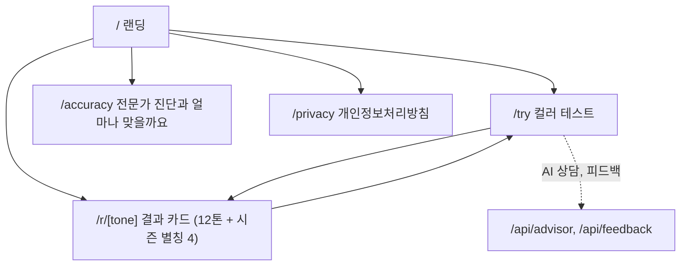
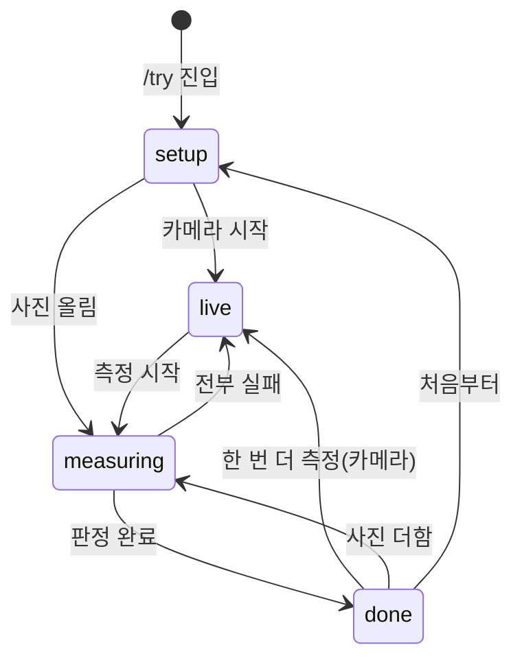
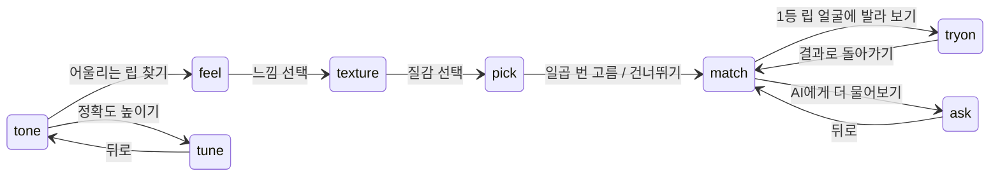
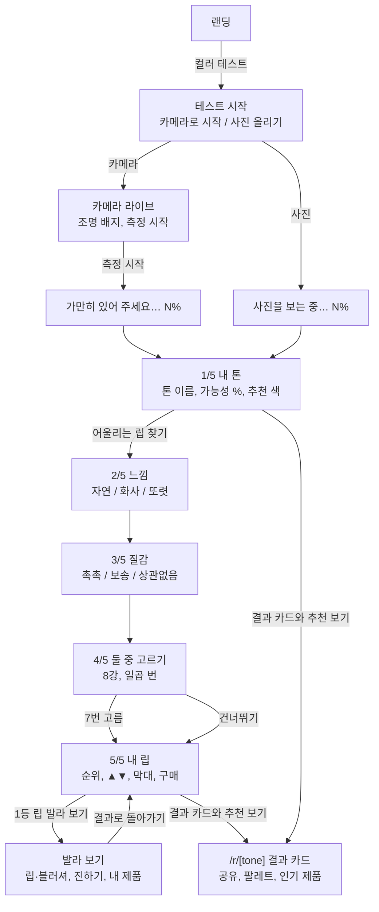
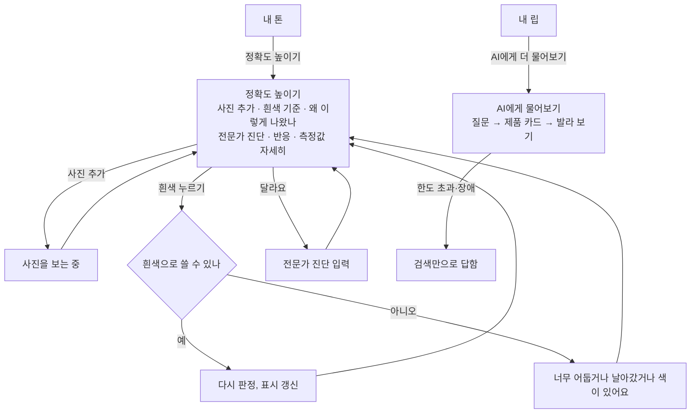

# 5. 정보구조와 사용자 흐름

> **구조:** 페이지는 다섯 개뿐이고(랜딩, 컬러 테스트, 결과 카드 12+4, 정확도, 개인정보처리방침), 일은 거의 전부 컬러 테스트 한 페이지 안의 단계(step)로 흐른다. 본 흐름 다섯 단계에 곁가지 둘, 한 화면에 한 가지 일.

기준일 2026-11-11.

---

## 1. 사이트맵

헤더는 모든 페이지에 같다: 로고(톤빛), 12 TONES(랜딩의 12톤 섹션), COLOR TEST(/try). 상단 띠에 "사진은 기기 밖으로 나가지 않아요"가 늘 보인다. 푸터는 정확도, 개인정보처리방침, GitHub.

## 2. 컬러 테스트의 상태

측정 단계(stage)와 결과 화면 단계(step) 두 축이다. stage가 done이 되어야 step이 의미가 있다.

step은 브라우저 히스토리에 얹는다. 첫 단계는 현재 항목을 바꾸고(replace), 다음 단계부터 쌓는다(push). 뒤로 가기는 popstate로 단계만 되돌린다. 곁가지에서 나오는 "뒤로"도 같은 동작이다.

## 3. 본 흐름

## 4. 곁가지와 분기

| 분기 | 조건 | 가는 곳 |
|---|---|---|
| 카메라 거부·미지원 | 권한 거부, getUserMedia 없음 | 테스트 시작 화면에서 사진 올리기가 주 행동으로 |
| 얼굴 없음 | 모든 사진 실패 | 안내 문구, 측정 전 상태 |
| 일부 실패 | N장 중 M장 실패 | 빼고 합침, 문구 |
| 5장 초과 | room 넘침 | 앞 5장만, 문구 |
| 두 톤 경계 | 확신도 낮음 | 내 톤에 경계 안내 |
| 사진마다 갈림 | votes가 둘 이상 | 탭 아래 가운데 값 안내, 경계 안내는 생략 |
| 조명 색 섞임 | warm·cool·greenCast이고 완전 보정 아님 | 정확도 높이기의 흰색 기준 섹션이 펼쳐진 채 |
| 둘 중 고르기에 얼굴 없음 | 카메라 스냅샷·사진 없음 | 건너뛰기만 |
| AI 꺼짐 | 환경 변수 없음 | 버튼 자체가 없음 |

## 5. 모바일과 데스크톱의 차이

| 항목 | 모바일(390px) | 데스크톱(1280px) |
|---|---|---|
| 사진 무대 | 위에 작게(내 톤 30svh), 발라 보기에서만 위에 고정하고 스크롤하면 접힘, 질문·고르기·순위 화면에서는 숨김 | 왼쪽에 고정, 오른쪽이 단계 패널 |
| 주 행동 버튼 | 아래에 붙음(sticky) | 패널 안 제자리 |
| 사진별 탭 | 가로 스크롤 | 한 줄 |
| 발라 보기 | 사진을 꾹 누르면 바르기 전, 짧게 누르면 크게 보기 | 같음 |
