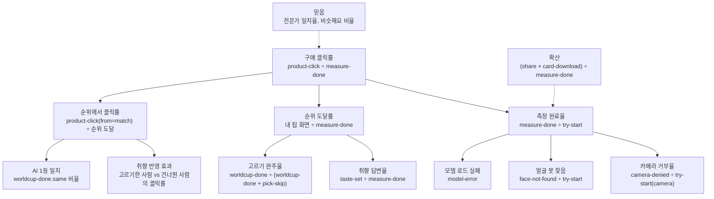

# 7. 지표와 이벤트 설계

> **북극성 지표:** 측정을 끝낸 사람 중 구매 링크를 누른 비율. 서비스의 의도가 "진단에서 구매로"이기 때문이다. 정확도는 별도 축으로 공개한다.

기준일 2026-11-11. 도구는 Umami(쿠키 없음, 개인 식별 없음). 이벤트에는 얼굴·측정 수치를 싣지 않는다.

---

## 1. 지표 트리

## 2. 퍼널

| 단계 | 이벤트 | 보는 것 |
|---|---|---|
| 1 방문 | 페이지뷰 / | 유입 경로(결과 카드 공유, 검색) |
| 2 시작 | try-start(source) | 카메라·사진 비율 |
| 3 측정 완료 | measure-done(tone, confidence, source) | 톤 분포, 확신도 분포, 소스별 완료율 |
| 4 취향 | taste-set(feel, texture) | 느낌·질감 분포 |
| 5 고르기 | worldcup-done(same) / pick-skip | 완주율, AI 1등과 같은 비율 |
| 6 순위 | step-view(step=match) | 단계별 도달 수. 셀프 리뷰 뒤 추가한 이벤트 |
| 7 구매 | product-click(id, from, rank) | 화면별 클릭, 몇 위를 누르나 |

퍼널은 4주마다 본다. 측정 완료율이 60% 아래면 2~3단계(권한·조명·모델)를, 구매 클릭률이 5% 아래면 순위 화면(문구·꼴찌 비교·링크 위치)을 먼저 본다.

## 3. 이벤트 정의표

| 이벤트 | 언제 | 속성 | 쓰는 지표 |
|---|---|---|---|
| try-start | 카메라 시작 또는 사진 올림 | source: camera / image | 시작 수, 소스 비율 |
| camera-denied | 카메라 권한 거부 | | 거부율 |
| model-error | 얼굴 인식 모델 로드 실패 | | 실패율 |
| face-not-found | 얼굴 못 찾음 | source | 실패율 |
| measure-done | 판정 완료(여러 장은 한 번) | tone, confidence, source, shots(합친 장수) | 완료율, 톤·확신도 분포, 장수별 확신도 |
| step-view | 측정 뒤 화면이 바뀔 때마다 | step: tone / feel / texture / pick / match / tryon / tune / ask | 단계별 이탈 |
| swatch-select | 발라 보기에서 색 선택 | kind: lip / blush, product: 제품 여부 | 발라 보기 활동 |
| wb-lock | 흰 종이 화이트밸런스 고정 | | 기능 사용률 |
| drape-done | 셀프 비교 완료 | season, same | |
| taste-set | 느낌·질감 답함 | feel, texture | 취향 분포, 답변율 |
| pick-skip | 둘 중 고르기 건너뜀 | | 완주율 |
| worldcup-done | 일곱 번 다 고름 | same: 끝까지 이긴 립이 AI 1등과 같은지 | 완주율, 일치율 |
| shade-saved | 내 제품 색 저장 | kind | 기능 사용률 |
| advisor-ask | AI 질문 | | 상담 사용률 |
| advisor-try-on | AI 답의 발라 보기 | | |
| share | 공유 | | 확산 |
| card-download | 카드 저장 | | 확산 |
| product-click | 구매 링크 클릭 | id, from: match / faceoff / tryon / result / advisor, rank(순위 화면) | 북극성 |

product-click은 코드가 아니라 링크의 `data-umami-event` 속성으로 남긴다. 그래서 새 화면에 링크를 둘 때 속성 세 개(event, id, from)만 붙이면 된다.

## 4. 서버에 남는 것

| 테이블 | 무엇 | 왜 |
|---|---|---|
| feedback | 측정 숫자(Lab, ITA, 색상각, 보정 기준)와 전문가 진단 톤 | 일치율 공개, 매주 재보정 |
| result_reactions | 판정·보정 기준과 비슷해요·잘 모르겠어요·달라요 | 체감 정확도 |
| advisor_ratings | 답에 붙은 제품 id와 도움이 됐어요·아쉬워요 | 상담 품질 |
| advisor_usage | 일별 호출 수 | 한도 |

얼굴·사진·글은 어디에도 남지 않는다.

## 5. 정확도 지표

| 지표 | 정의 | 공개 |
|---|---|---|
| 전문가 시즌 일치율 | 전문가 진단 시즌 = 톤빛 시즌 ÷ 제출 수 | /accuracy, 시즌별·흰색 보정별 |
| 체감 일치율 | 비슷해요 ÷ (비슷해요 + 달라요) | /accuracy |
| AI 상담 체감 | 도움이 됐어요 비율, AI 답과 검색 폴백 구분 | /accuracy |
| 재보정 이득 | 5겹 교차검증 일치율 − 지금 기준 일치율 | PR 본문 |

## 6. 실험 후보

지표가 쌓이면 먼저 볼 두 가지.

| 가설 | 바꾸는 것 | 보는 지표 |
|---|---|---|
| 둘 중 고르기를 한 사람이 더 산다 | 없음(이미 분기됨) | 고르기 완주 vs 건너뛰기의 product-click 비율 |
| 꼴찌 비교가 1등 클릭을 늘린다 | 비교를 접어 둠 vs 펼쳐 둠 | from=match rank=1 클릭률 |
