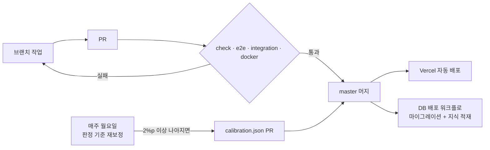

# 8. 출시·운영 계획

> **출시 기준:** CI 네 작업이 전부 통과하고, 폰·데스크톱에서 다섯 단계를 끝까지 손으로 한 번 돌리고, 사진이 밖으로 안 나가는 걸 네트워크 탭으로 확인한 뒤 master에 머지한다. 머지하면 Vercel이 자동으로 배포한다.

기준일 2026-11-11.

---

## 1. 출시 전 확인

- [x] 단위 테스트(Vitest), E2E(Playwright, 가짜 카메라), 통합(Postgres), 도커 빌드 네 작업 통과
- [x] 폰(390px)과 데스크톱(1280px)에서 내 톤 → 느낌 → 질감 → 둘 중 고르기 → 내 립 → 발라 보기 → 결과 카드까지 손으로 한 바퀴
- [x] 네트워크 탭에 이미지 업로드 요청이 없고, CSP가 `connect-src 'self'`
- [x] 카메라 거부 → 사진 올리기로 넘어감
- [x] 얼굴 없는 사진 → 안내 문구
- [x] 사진 두 장 → 머리말 "사진 2장을 합친"과 탭 3개
- [x] 모든 화면 문구가 완전한 문장이고 용어가 없음(캡처 감사)
- [x] 개인정보처리방침, 정확도 페이지, 파트너스 고지
- [x] OG 카드 12톤 렌더
- [x] 연락처가 어느 페이지에도 없음

## 2. QA 시나리오

| ID | 시나리오 | 기대 결과 | 자동화 |
|---|---|---|---|
| Q-01 | 카메라 권한 거부 | "카메라 권한이 거부됐어요", 사진 올리기 보임 | E2E |
| Q-02 | 가짜 카메라로 라이브 진입 | "얼굴을 찾는 중", 측정 시작 비활성 | E2E |
| Q-03 | 얼굴 없는 1×1 PNG | "얼굴을 찾지 못했어요" | E2E |
| Q-04 | 셀카 한 장 → 다섯 단계 → 발라 보기 → 결과 카드 | 톤 제목, 팔레트, 순위, 칩 선택, /r/[tone] | E2E |
| Q-05 | 사진 두 장 | "사진 2장을 합친 내 퍼스널 컬러", 탭 3개, 탭 누르면 "사진 한 장으로 본" | E2E |
| Q-06 | 브라우저 뒤로 가기 | 이전 단계로 | E2E |
| Q-07 | 느낌 선택 + 질감 상관없음 → 항목 막대 | 막대 8개 | E2E |
| Q-08 | 흰 종이 사진과 형광등 사진 | 형광등 사진의 색상각이 보정 뒤 흰 종이 사진에 가까워짐 | E2E |
| Q-09 | 내 제품 색 재기(스와치) | 칩 추가, localStorage 저장 | E2E |
| Q-10 | 전문가 진단 제출 → 정확도 페이지 | DB 저장, 일치율 갱신 | 통합 |
| Q-11 | AI 상담(가짜 Gemini) | 제품 카드, 발라 보기 | 통합 |
| Q-12 | iOS Safari 실기기 카메라·앨범 | 권한, 발색 | 수동 |
| Q-15 | EXIF로 눕혀 저장된 사진 | 세로로 바로 세워 측정 | E2E |
| Q-13 | 5장 초과 업로드 | "N장은 뺐어요" | 수동 |
| Q-14 | 어울림 점수 분포 | 1등 80~89, 중앙값 35~76, 100 없음 | 단위 |

## 3. 릴리즈 절차

- 커밋은 `type : 설명` 형식, PR은 템플릿대로. 머지 전 CI 네 작업 통과.
- 환경 변수는 Vercel(`DATABASE_URL`, `GEMINI_API_KEY`, 선택 `GEMINI_MODEL`, `ADVISOR_DAILY_CAP`, `NEXT_PUBLIC_ADVISOR_ENABLED`)과 GitHub Secrets 두 곳. 값이 없으면 그 기능만 꺼진다.
- OG 카드나 톤 설명 문구를 바꾸면 한글 서브셋 폰트를 다시 만든다.
- 제품 데이터 갱신은 분기마다. 공식 칩 색과 베스트 순위를 바꾸고 단종을 뺀다.

## 4. 모니터링

| 무엇 | 어디서 | 주기 |
|---|---|---|
| 퍼널과 이벤트 | Umami | 주 1회 |
| 전문가 일치율, 체감 일치율 | /accuracy | 배포마다, 주 1회 |
| 오류·함수 실행 | Vercel 로그 | 배포 직후 |
| 재보정 결과 | GitHub Actions PR | 매주 월요일 |
| Supabase 일시정지 | 주간 워크플로가 깨움 | 자동 |
| AI 일일 한도 | advisor_usage | 주 1회 |

## 5. 리스크

| 리스크 | 영향 | 가능성 | 대응 |
|---|---|---|---|
| 조명 때문에 결과가 사진마다 다름 | 신뢰 하락 | 높음 | 치아·흰자·흰 종이 보정, 여러 장 합치기, 경계 안내, 일치율 공개 |
| 기준값이 전문가 진단과 어긋남 | 신뢰 하락 | 중간 | 매주 재보정, 50건·2%p 문턱, 사람 머지 |
| iOS 카메라·사진 회전 문제 | 측정 실패 | 중간 | 업로드 경로 보장, 실기기 수동 QA |
| Vercel Hobby 비상업 조건 | 서비스 중단 | 낮음(수익 전) | 수익이 붙으면 Pro·다른 호스팅으로. 플랫폼 종속 없음 |
| Gemini·Supabase 무료 등급 한도 | 상담·피드백 정지 | 중간 | 한도와 폴백, 값 없으면 기능만 꺼짐 |
| 제품 데이터 낡음 | 추천 품질 | 중간 | 분기 갱신, 공식 칩 |
| 대형 유통사의 같은 기능 | 유입 감소 | 중간 | 중립 추천, 기기 내 처리, 취향 학습. 지표가 안 나오면 접음 |
| 얼굴 사진 처리에 대한 오해 | 신뢰 하락 | 낮음 | 상단 띠, 랜딩 문단, 처리방침, CSP |

## 6. 로드맵

실제로 한 일은 [서비스 기획서 9절](./02-service-plan.md#9-실제-진행)에 있다. 앞으로는 지표를 본 뒤 정한다.

| 단계 | 조건 | 할 일 |
|---|---|---|
| 지금 | 출시됨 | 4주 퍼널 데이터 모으기. 목표 숫자를 가설에서 실측으로 |
| 다음 | 측정 완료율 60% 미만이면 | 권한·조명·모델 로딩 구간 손보기 |
| 다음 | 구매 클릭률 5% 미만이면 | 순위 화면 문구, 꼴찌 비교, 링크 위치 실험 |
| 다음 | 전문가 제출 50건이 모이면 | 첫 재보정 PR 검토 |
| 이후 | 외국인 유입이 잡히면 | 영어 지원 |
| 이후 | 립 지표가 안정되면 | 블러셔·아이섀도 순위 |
